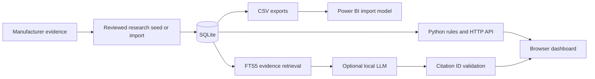

# Portfolio Lens — Business Laptop Competitive Intelligence

A local research application for comparing business-laptop capabilities, screening a portfolio against explicit requirements, and tracing conclusions back to manufacturer evidence.

**Python · SQLite · SQL · Power BI · JavaScript · optional local RAG**

Built with AI assistance. This is a working, single-user portfolio project with a curated research baseline. It is not a deployed production service or an exhaustive, continuously updated market database.

## The business question

Which researched laptop platforms could support a serviceable business fleet, which fail the requirements, and which need more evidence?

For a screen of at least 64 GB supported memory, at most 1.5 kg starting weight, and upgradable RAM, the seed identifies the ThinkPad T14 Gen 6 Arrow Lake and HP EliteBook 840 G11 as research candidates. Dell Latitude 5450 is unresolved because its weight is unverified in this dataset. A candidate still needs verification against an actual purchasable configuration.

## What is included

- Nine platform variants across seven product families and five brands.
- Ten manufacturer evidence records, with source links and research dates.
- Search, comparison, requirement screening, reviewed JSON imports and change history.
- SQLite constraints, joins, analytical views and FTS5 evidence retrieval.
- Source fingerprint checks that flag pages for human review.
- A four-page Power BI report with seven imported tables and seven measures.
- An optional local language model for evidence-based explanations.
- Seventeen automated business-rule and data-integrity tests.

The research baseline is dated **September 11, 2026**. It includes two historical launches and one historical price observation. It does not establish current prices, stock, market share or measured performance.

## Run the source project

Use Python 3.10 or later with SQLite FTS5 support. The Python application uses only the standard library; there is no application package-install step.

1. Download or clone this repository and open a terminal in its root folder.
2. Run `python launch.py --no-model`.
3. Open `http://127.0.0.1:8765/` if the browser does not open automatically.

The database is created from `data/seed.json` on first startup. The source package excludes the working database, Python executable, model weights, local tokens and runtime caches. Evidence search and all deterministic comparisons work without a language model.

The address is local to the computer running the server. Run the launcher again after restarting the computer. Opening `dist/index.html` directly does not start the backend. Run only one project copy at a time.

On Windows, `Stop Portfolio Lens.ps1` stops the recorded project processes. For foreground development, run `python app.py --no-browser` and stop it with Ctrl+C.

## Optional local AI

The original Windows portable build uses Qwen2.5-1.5B-Instruct Q4_K_M with llama.cpp. Model training and fine-tuning are not part of this project.

To use the same local setup, place the model at `runtime/model.gguf` and the Windows llama.cpp runtime, including its DLLs, under `runtime/llama/` with `llama-server.exe` inside it. Keep the third-party licenses with these downloads. Run `python launch.py`. The launcher creates a new local access token automatically.

You can obtain the components from the [official Qwen model repository](https://huggingface.co/Qwen/Qwen2.5-1.5B-Instruct-GGUF) and [llama.cpp releases](https://github.com/ggml-org/llama.cpp/releases). The original portable build used llama.cpp b10537. Compatibility with arbitrary newer versions has not been tested. A local Ollama model is another supported connection path when the bundled llama.cpp service is absent.

## Architecture



Portfolio, price, weight and market-change questions use deterministic rules. Other evidence questions can use retrieved summaries and the local model. The model never executes generated SQL. Valid source IDs do not prove that every generated statement is correct.

## Power BI

Run the launcher once to set the report's local data-folder parameter. Open `powerbi/Portfolio Lens.pbip` in Power BI Desktop, then select Refresh. Power BI Desktop is a separate application. Project/PBIR support must be available in the installed version.

The pages cover market overview, portfolio fit, pricing evidence, and sources/changes. The report imports exported CSV files; it is not a live DirectQuery connection. After changing research, update the exports in the dashboard and refresh Power BI.

The `DataFolder` placeholder in the committed semantic model is replaced locally by the launcher. Close Power BI before moving the project and rerun the launcher afterward. Avoid committing a machine-specific DataFolder path back to GitHub.

## Explore the code

| File | Responsibility |
| --- | --- |
| `data/seed.json` | Reproducible manufacturer research baseline |
| `schema.sql` | Tables, constraints, relationships, views and search index |
| `analysis.sql` | Readable analytical queries |
| `app.py` | Data access, screening, retrieval, import/export and HTTP API |
| `dist/` | Browser interface and interactions |
| `launch.py` | Service startup and Power BI folder configuration |
| `powerbi/` | Report definitions, semantic model, generators and CSV exports |
| `tests/test_intelligence.py` | Business-rule and integrity regression tests |

Read [architecture and trade-offs](docs/ARCHITECTURE.md) and the [demo walkthrough](docs/DEMO.md) for explanations.

## Verify

```text
python -m unittest discover -s tests -v
python app.py --export
```

With Node.js installed, `node --check dist/app.js` checks JavaScript syntax. Node is not required to run the application.

Tests cover missing values, inclusive boundaries, platform separation, known fleet candidates, SQL constraints, source-linked prices, research rollback, audit history and deterministic AI routing. The [validation record](VALIDATION.md) separates automated checks from manual Power BI checks and identifies the absence of browser visual testing.

## Research and operating limits

- Platform maxima and starting weights may describe different configurations.
- Unknown specifications are unresolved evidence, not zero or absent capabilities.
- Sample coverage is not market share or a claim about a brand's complete portfolio.
- Historical launch prices cannot establish today's value ranking.
- A page-hash change triggers review; it does not automatically change product facts.
- The local model can make errors, and retrieval has not been evaluated against a labelled question benchmark.
- Authentication, multiple organisations, scheduled crawling and cloud deployment are not implemented.
- The HTTP service is for local use. This architecture has not been hardened or load-tested as a public production service.
